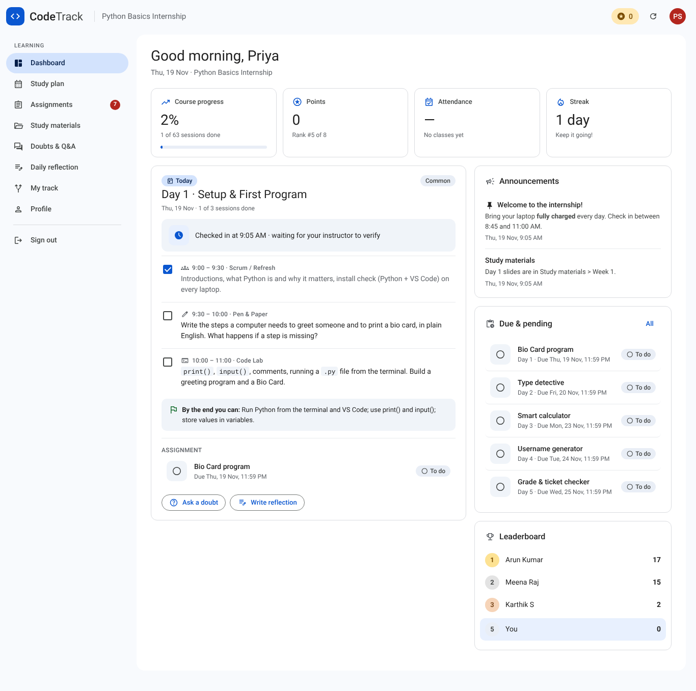
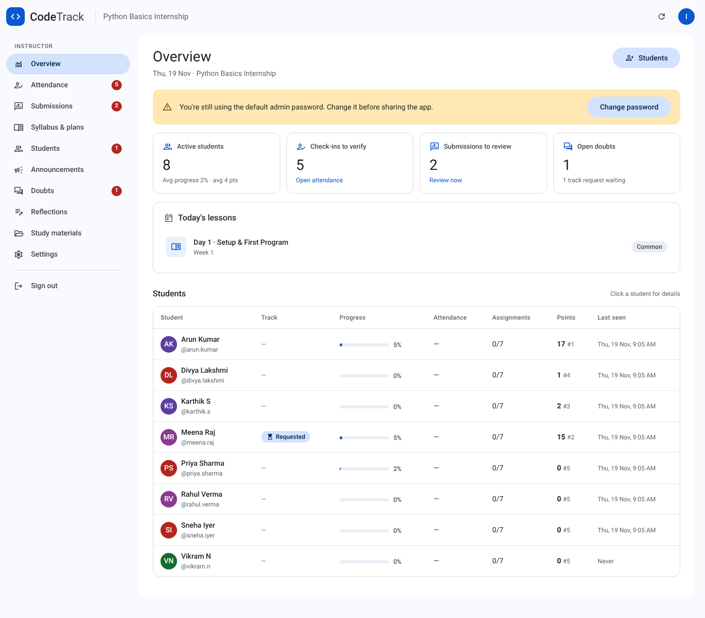

# CodeTrack

A lightweight learning management system for a 21-day Python internship, running entirely on **Google Apps Script** with a **Google Sheets** database and **Google Drive** for study materials and submissions.

**Live app:** [https://script.google.com/macros/s/…/exec](https://script.google.com/macros/s/AKfycbw-19S3PMFzT7JrXCopO9VCjoY-Ari7A6k36qO8IZNZQFPkaGIYxdtQV9YrOpPZuWRNCg/exec)

| Student view | Instructor view |
|---|---|
|  |  |

## Features

**Students**: today's lesson split into Scrum / Pen & Paper / Code Lab with a checklist · "I'm here" check-in · submit code (paste or upload `.py`) and see review status & comments · study materials from Drive with in-app preview · doubts & class Q&A · daily reflection · choose a specialization track · points, rank, attendance and streak.

**Instructor**: overview of every student · verify check-ins / mark attendance · review & approve submissions · publish weeks, edit days and assignments, import/export the syllabus as JSON · approve track requests · announcements · answer doubts · read reflections · award bonus points.

**Tracks** (after common Days 1–12): Data Analysis · Web Development · Automation & Scripting · AI & Machine Learning.

## Repository layout

```
apps-script/      Files to paste into the Apps Script project
  Code.gs         Backend: sheet DB, auth, routes, setup()
  Seed.gs         Default 21-day syllabus (generated from syllabus.json)
  Index.html      Page shell
  Styles.html     Styling
  App.html        Front end (student + admin)
  appsscript.json Manifest (Asia/Kolkata, web app settings)
syllabus.json     Editable syllabus — import via Admin → Syllabus → JSON
SETUP.md          Step-by-step deployment and daily-use guide
tools/            Offline test harness (mocked Google services, UI tests)
```

## Quick start

See **[SETUP.md](SETUP.md)**. In short: paste `apps-script/*` into a new Apps Script project → run `setup()` → Deploy as web app (Execute as *Me*, access *Anyone*) → sign in as `admin` and change the password.

## Development

```bash
cd tools
python3 build_syllabus.py           # regenerate syllabus.json + Seed.gs
node test_backend.js                 # backend tests against mocked Sheets/Drive
npm i material-symbols @fontsource/roboto @fontsource/roboto-mono @highlightjs/cdn-assets
node build_preview.js && python3 ui_test.py   # UI click-through + screenshots (Playwright)
```
